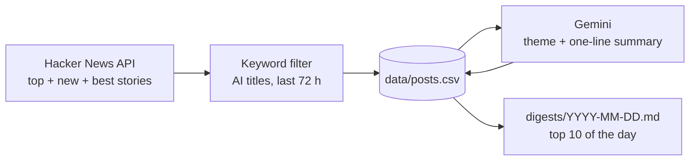

# AI News Radar

[](https://github.com/Osceti/ai-news-radar/actions/workflows/ci.yml)
[](https://github.com/Osceti/ai-news-radar/actions/workflows/daily-radar.yml)

A daily AI news digest built on the [Hacker News API](https://github.com/HackerNews/API).
Every day a GitHub Action collects the AI stories posted on Hacker News, asks an LLM
(Gemini) to label each one with a theme and a one-sentence summary, and commits a
Markdown digest of the ten most important stories to [`digests/`](digests/).

## The problem

Hacker News is one of the best places to follow AI as it happens, but on a typical day
more than a hundred AI-related stories go by, mixed with everything else on the site.
Following it closely takes time, and skimming the front page misses stories that were
popular overnight.

AI News Radar answers one question each day: *what were the ten AI stories that people
on Hacker News cared about most, and what are they about?* It also keeps every story in a
dataset, so trends (which themes rise or fade over time) can be analysed later.

## How it works



1. **Collect** ([`radar/hn.py`](radar/hn.py), [`radar/filters.py`](radar/filters.py)).
   The official API has no search endpoint, so the radar reads the ids of the current
   top, new and best stories (about 1,000 unique ids), fetches each item concurrently and
   keeps stories posted in the last 72 hours whose title matches a curated list of AI
   keywords (acronyms such as `LLM` or `RAG` are matched case-sensitively to avoid false
   positives like "rag" or "Ai Weiwei").
2. **Store** ([`radar/storage.py`](radar/storage.py)). Stories are upserted into
   [`data/posts.csv`](data/posts.csv), one row per story id: a story seen again gets its
   latest score and comment count, and keeps its theme and summary, so there are no
   duplicates and no story is classified twice.
3. **Classify** ([`radar/classifier.py`](radar/classifier.py)). Unlabelled stories are sent
   to the Gemini API in batches of 25. Structured output constrains each answer to one of
   nine fixed themes (models, agents, RAG, dev tools, security, research, business,
   regulation, other) plus a one-sentence summary written only from the title and the
   link domain. Rate-limit errors are retried with exponential backoff, and stories that
   still fail are retried on the next run.
4. **Digest** ([`radar/digest.py`](radar/digest.py)). The ten stories posted on the
   previous UTC day (00:00 to 24:00) with the most points + comments are written to
   `digests/YYYY-MM-DD.md`, grouped by theme, with the link, the summary and the Hacker
   News discussion.

The [daily workflow](.github/workflows/daily-radar.yml) is scheduled at 06:00 UTC: it runs
the test suite, then the pipeline, then commits the updated CSV and the new digest.
GitHub often starts scheduled runs hours late, so each digest is tied to the day it
covers rather than to the time of the run, and the 72-hour collection window means a late
run loses nothing. A missed day can be rebuilt from **Actions → Daily radar → Run
workflow** by entering its date.
A [CI workflow](.github/workflows/ci.yml) runs the tests on every push and pull request.

### Data

`data/posts.csv` has one row per story:

| Column | Description |
| --- | --- |
| `id` | Hacker News item id |
| `created_at` | When the story was posted (UTC, ISO 8601) |
| `title`, `url`, `domain` | Story title and link (`url` is the discussion for Ask HN posts) |
| `hn_url` | Hacker News discussion |
| `score`, `num_comments` | Points and comments at the latest collection |
| `author` | Hacker News username |
| `keywords` | AI keywords that matched the title |
| `theme`, `summary` | Gemini's label and one-sentence summary (empty until classified) |
| `collected_at` | When the row was last updated |

## Example digest

An excerpt of [`digests/2026-11-12.md`](digests/2026-11-12.md), the first digest
(every digest is in [`digests/`](digests/)):

> # AI News Radar — 2026-11-12
>
> Top 10 of 147 AI-related stories posted on Hacker News on Thursday 12 November 2026 (UTC), ranked by points + comments and grouped by theme.
>
> ## Models
>
> - **[Gemini 4 Hydrogen](https://blog.google/innovation-and-ai/models-and-research/gemini-models/introducing-gemini-4-hydrogen/)** (blog.google)\
>   The Google blog discusses Gemini 4 Hydrogen.\
>   572 points · 353 comments · [discussion](https://news.ycombinator.com/item?id=50471431)
> - **[Edge0-145B: Frontier AI Capabilities on Your Own Computer](https://edge0.ai/blog/introducing-edge0-145b-frontier-ai-capabilities-on-your-own-computer)** (edge0.ai)\
>   Edge0-145B brings frontier AI capabilities to your own computer.\
>   357 points · 105 comments · [discussion](https://news.ycombinator.com/item?id=50475713)
>
> ## Agents
>
> - **[Claude Code and Codex reverse engineered my 1994 Jeep's ECU over a $3 Arduino \[video\]](https://www.youtube.com/watch?v=WPj3aQ-xxpI)** (youtube.com)\
>   A video demonstrates Claude Code and Codex reverse engineering a Jeep ECU over an Arduino.\
>   453 points · 239 comments · [discussion](https://news.ycombinator.com/item?id=50463399)
>
> *…*

## Run it locally

Requires Python 3.11+.

```bash
git clone https://github.com/Osceti/ai-news-radar.git
cd ai-news-radar
python -m venv .venv && source .venv/bin/activate
pip install -r requirements-dev.txt
```

Run the tests:

```bash
pytest
```

Run the whole pipeline (collect, classify, digest). Without a key, stories are stored
unclassified and the digest is still written; they are classified on the next run that
has a key.

```bash
export GEMINI_API_KEY="your-key"   # free key from https://aistudio.google.com/apikey
python -m radar run
```

Each step can also run on its own: `python -m radar collect`, `python -m radar classify`,
`python -m radar digest`. Use `--date YYYY-MM-DD` to build the digest of a given UTC day
(default: yesterday), `--window-hours` to change the 72-hour collection window, and
`--data` and `--digests` to write somewhere else.

### Configuration

| Variable | Where | Default | Purpose |
| --- | --- | --- | --- |
| `GEMINI_API_KEY` | environment / repository secret | none | Gemini API key, never stored in the code |
| `GEMINI_MODEL` | environment / repository variable | `gemini-flash-lite-latest` | Gemini model used for classification |

To run the daily workflow on a fork, add `GEMINI_API_KEY` under **Settings → Secrets and
variables → Actions → New repository secret**, then start **Actions → Daily radar → Run
workflow**.

## Project structure

```text
radar/
  config.py       paths, window, digest size and the fixed list of themes
  filters.py      AI keyword filter
  hn.py           Hacker News API client
  storage.py      CSV storage with upsert
  classifier.py   Gemini classification and summaries
  digest.py       ranking and Markdown rendering
  pipeline.py     collect, classify and digest steps
  evaluation.py   sampling, blind labelling and metrics for the classifier
  __main__.py     command line interface
tests/            pytest suite (no network access needed)
eval/             evaluation sample, reference labels and report
data/posts.csv    every AI story collected so far
digests/          one Markdown digest per day
```

## Evaluation

**Method.** 100 classified stories were drawn at random (seed 42) from the first week of
data. They were labelled blind (without Gemini's answer) by an independent LLM from
another vendor, given the same theme definitions as Gemini and the extra option `not-ai`
to flag stories the keyword filter should not have kept. The prompt is in
[`eval/annotation_prompt.txt`](eval/annotation_prompt.txt), the reference labels in
[`eval/judge_labels.csv`](eval/judge_labels.csv) and the full report, with the confusion
matrix and every disagreement, in [`eval/report.md`](eval/report.md).

| Metric | Result |
| --- | --- |
| Keyword filter precision (stories really about AI) | **97%** (97/100) |
| Theme accuracy on AI stories | **77%** (75/97), 95% CI 68–85% |
| Best themes (precision / recall) | security 100/100, regulation 100/100, business 95/95 |
| Weakest theme | dev-tools: 57% precision (28 predicted, 20 in the reference) |

**Where Gemini goes wrong.**

- **"dev-tools" is a catch-all.** 9 of the 22 disagreements are stories the reference put
  in *other* that Gemini called *dev-tools*: consumer apps built on LLMs (a local chat app
  for iPhone, offline meeting notetakers) and opinion pieces or Ask HN threads *about* AI
  coding. Gemini reads "software that uses AI" as "a tool for building with AI".
- **agents vs dev-tools.** MCP servers and agent-oriented project tools land on either
  side depending on the annotator; the definitions overlap for tools *used by* agents.
- **Commentary vs substance.** An educational video on post-training was labelled
  *models*, and an essay on AGI timelines *research*; the reference saw both as *other*.
  The reverse also happens: a story about finding a dwarf planet with Claude is
  *research* for the reference and *other* for Gemini.
- **Keyword filter.** The 3 false positives are a post about the Gemini small-web
  network (the filter excludes "Gemini protocol" but not "Gemini network"), "ML Modules"
  (ML the programming language) and a board game named "AI Race".

**Limits of this evaluation.**

- The reference is another LLM, not a human. Where both models make the same mistake, it
  goes unnoticed, so 77% is closer to an upper bound. The one story also labelled by hand
  illustrates this: both models chose *agents* for "Claude reverse engineered my Jeep",
  the human chose *models*.
- With 100 stories the interval is wide (±9 points), and rare themes are barely measured:
  the sample contains no *rag* story and only 4 *research* ones.

Reproduce with `python -m radar eval-sample`, `python -m radar eval-prompt` (or
`eval-label` to label by hand in the terminal) and
`python -m radar eval-report --reference eval/judge_labels.csv --annotator "an independent LLM"`.

## Limitations

- Only titles are filtered, so an AI story with a title that names no AI keyword is
  missed, and a few generic matches (for example "AI" in a non-AI story) get through.
- The Hacker News API exposes the latest 500 new stories, which covers roughly the last
  half day; older stories are found through the top and best lists, which favours the
  popular ones, exactly the ones a digest needs. Since runs happen once a day, a few
  low-scoring stories are never seen.
- Summaries are written from the title and domain only, without reading the article.
- Points and comments are a snapshot at collection time, so a story posted late in the
  day is ranked on a score only a few hours old.

## Roadmap

- [x] Daily collection, Gemini classification and digest
- [x] Evaluation of the classifier on 100 stories
- [ ] Tighter theme definitions for dev-tools, then re-evaluate
- [ ] Notebook on how themes evolve over time
- [ ] Streamlit dashboard

## License

[MIT](LICENSE)
