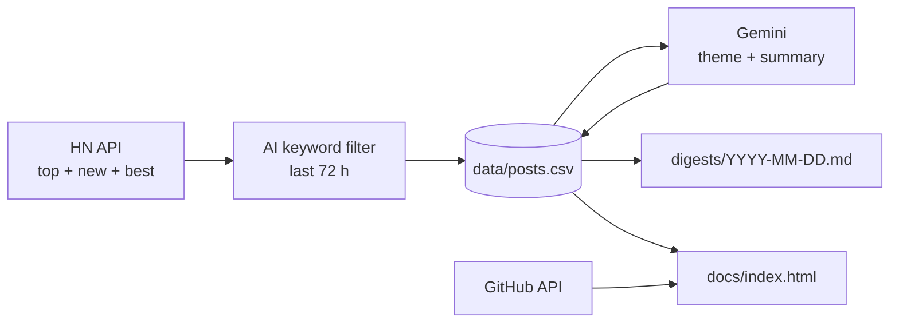

# AI News Radar

**AI news and the best GitHub of the week**, from Hacker News, updated daily.
**[→ Open the dashboard](https://osceti.github.io/ai-news-radar/)**

[](https://github.com/Osceti/ai-news-radar/actions/workflows/ci.yml)
[](https://github.com/Osceti/ai-news-radar/actions/workflows/daily-radar.yml)

I read Hacker News to keep up with AI, but there are 100+ AI stories a day and I kept
missing the ones that blew up overnight. So I built a small radar: every morning a GitHub
Action collects the AI stories from the [Hacker News API](https://github.com/HackerNews/API),
Gemini gives each one a theme and a one-line summary, and the ten biggest stories of the day
end up in a Markdown digest in [`digests/`](digests/).

Everything is kept in a CSV, so I can also look at trends over time on the
[dashboard](https://osceti.github.io/ai-news-radar/). It also lists the best GitHub
repositories of the week: the ones Hacker News discussed most, and the new AI repositories
collecting the most stars.

## How it works



- **Collect** (`radar/hn.py`, `radar/filters.py`): the API has no search, so I fetch the
  top, new and best story ids (~1,000), then keep stories from the last 72 hours whose
  title matches a list of AI keywords. Acronyms like `LLM` and `RAG` are case-sensitive,
  otherwise "rag" and "Ai Weiwei" get in.
- **Store** (`radar/storage.py`): one row per story in `data/posts.csv`. When a story
  comes back, its score and comments are updated but its label is kept, so nothing is
  classified twice.
- **Classify** (`radar/classifier.py`): new stories go to Gemini in batches of 25. The
  structured output forces one of nine themes (models, agents, rag, dev-tools, security,
  research, business, regulation, other). Summaries only use the title and domain, the
  article itself isn't read.
- **Digest** (`radar/digest.py`): top 10 stories of the previous UTC day by points +
  comments, grouped by theme.
- **Dashboard** (`radar/site.py`, `radar/trends.py`, template `radar/dashboard.html`): a
  single static page with ECharts, rebuilt every day and served by GitHub Pages. The
  generated `docs/index.html` comes from `radar/dashboard.html` (`python -m radar site`),
  so edit the template, not `docs/index.html`: manual changes are overwritten on the next build.
- **Best GitHub of the week** (`radar/github.py`): two lists over the last 7 days.
  *Hot on Hacker News* takes the GitHub links from the week's AI stories, groups them by
  repository and ranks them by points + comments. *New & starred* searches repositories
  created this week with an AI topic (`llm`, `ai-agents`, `rag`, `mcp`...) and ranks them
  by stars. Stars, language and description come from the GitHub API, using the
  workflow's automatic `GITHUB_TOKEN`.

  The new-repository ranking was a surprise: on the first run, 8 of the top 10 were
  swarms of look-alike repos pushed by throwaway accounts, a known way to spread malware.
  So candidates are filtered first: no language detected, a name stem shared by 3+
  owners, almost as many watchers as stars (bots star and watch at the same time), or an
  account under 60 days old with fewer than 5 followers.

The workflow is scheduled at 06:00 UTC, but GitHub regularly starts scheduled jobs hours
late. That's why each digest is tied to the day it covers, not to when the job runs, and
the 72 h window means a late run doesn't lose stories. A missed day can be rebuilt from
**Actions → Daily radar → Run workflow** with its date.

The columns of `data/posts.csv`: `id`, `created_at`, `title`, `url`, `domain`, `hn_url`,
`score`, `num_comments`, `author`, `keywords` (the ones that matched), `theme`, `summary`,
`prompt_version` and `collected_at`.

## Example

The start of the first digest, [`digests/2026-11-12.md`](digests/2026-11-12.md):

> # AI News Radar — 2026-11-12
>
> Top 10 of 147 AI-related stories posted on Hacker News on Thursday 12 November 2026 (UTC), ranked by points + comments and grouped by theme.
>
> ## Models
>
> - **[Gemini 4 Hydrogen](https://blog.google/innovation-and-ai/models-and-research/gemini-models/introducing-gemini-4-hydrogen/)** (blog.google)\
>   The Google blog discusses Gemini 4 Hydrogen.\
>   572 points · 353 comments · [discussion](https://news.ycombinator.com/item?id=50471431)
> - **[Edge0-145B: Frontier AI Capabilities on Your Own Computer](https://edge0.ai/blog/introducing-edge0-145b-frontier-ai-capabilities-on-your-own-computer)** (edge0.ai)\
>   Edge0-145B brings frontier AI capabilities to your own computer.\
>   357 points · 105 comments · [discussion](https://news.ycombinator.com/item?id=50475713)
>
> ## Agents
>
> - **[Claude Code and Codex reverse engineered my 1994 Jeep's ECU over a $3 Arduino \[video\]](https://www.youtube.com/watch?v=WPj3aQ-xxpI)** (youtube.com)\
>   A video demonstrates Claude Code and Codex reverse engineering a Jeep ECU over an Arduino.\
>   453 points · 239 comments · [discussion](https://news.ycombinator.com/item?id=50463399)
>
> *…*

## Run it locally

Python 3.11+.

```bash
git clone https://github.com/Osceti/ai-news-radar.git
cd ai-news-radar
python -m venv .venv && source .venv/bin/activate
pip install -r requirements-dev.txt
pytest
```

```bash
export GEMINI_API_KEY="your-key"   # free key: https://aistudio.google.com/apikey
python -m radar run
```

Without a key it still collects and writes the digest, the stories just stay unlabelled
until a run that has one. Each step also runs on its own (`collect`, `classify`,
`digest`, `site`), and `--date YYYY-MM-DD` builds the digest of a given day. The model can
be changed with `GEMINI_MODEL` (default `gemini-flash-lite-latest`). `GITHUB_TOKEN` is
optional locally and only raises the GitHub API rate limit
(`export GITHUB_TOKEN=$(gh auth token)`).

For the notebook: `pip install -r requirements-analysis.txt`, then open
`notebooks/trends.ipynb`.

To run it on a fork, add `GEMINI_API_KEY` as a repository secret and trigger the
**Daily radar** workflow.

## Does the classifier work?

I wanted an actual number instead of "looks right". I drew two random samples of 100
stories from the first week: one to find mistakes and fix the prompt (`eval/`), one kept
aside to measure the result (`eval/test/`). Both were labelled blind by another model
from a different vendor (GPT-6 Astra), which could also answer `not-ai` to catch filter
mistakes.

On the held-out sample:

| | Prompt v1 | Prompt v2 |
| --- | --- | --- |
| Theme accuracy | 69% (CI 59–77%) | **73%** (CI 64–81%) |
| Recall on *other* | 52% | 74% |
| Precision on *models* | 53% | 78% |
| Keyword filter precision | 100% | 100% |

v2 fixed 11 stories and broke 7, so the gain goes in the right direction but isn't
significant with 100 stories (McNemar, p = 0.48). Reports with the confusion matrices
and every disagreement are in [`eval/test/`](eval/test/).

What I learned from the mistakes in v1:

- Gemini used *dev-tools* for anything "software + AI", including consumer apps and
  essays about AI coding. v2 limits it to tools for developers.
- MCP tools landed in *agents* or *dev-tools* almost at random. v2 puts MCP in *agents*,
  but the split is still the main source of errors.
- Explainers and opinion pieces were labelled *models* or *research*. They're *other*
  now.
- The filter let through a post about the Gemini small-web network, ML the programming
  language and a board game called "AI Race". Fixed.

The obvious limit: the reference is another LLM, not a person. When both models make the
same mistake I can't see it, so the scores are probably a bit optimistic. The one story I
labelled myself shows it: both models said *agents* for "Claude reverse engineered my
Jeep", I'd say *models*. And 100 stories is small, there's only one *rag* story across
both samples.

To reproduce: `python -m radar eval-sample`, `eval-prompt` (or `eval-label` to label by
hand), then `eval-report`. The **Evaluate classifier** workflow re-runs the samples with
the current prompt.

## Limitations

- Only titles are filtered, so an AI story without an AI word in its title is missed.
- The API only exposes the last 500 new stories (about half a day). Older ones come from
  the top and best lists, which is fine for a top 10 but means a few small stories are
  never seen.
- Scores are a snapshot: a story posted late in the day is ranked on a few hours of votes.
- GitHub has no API for its Trending page. *New & starred* ranks by total stars, which
  favours repos created early in the week, and the star-farming filter is a heuristic: it
  can miss a well-disguised campaign or, rarely, drop a real repo from a new account.
- *Hot on Hacker News* only sees GitHub links that are the story's URL, not links in the
  comments.

## Next

- Week-over-week trends once there's a month of data.

## License

[MIT](LICENSE)
