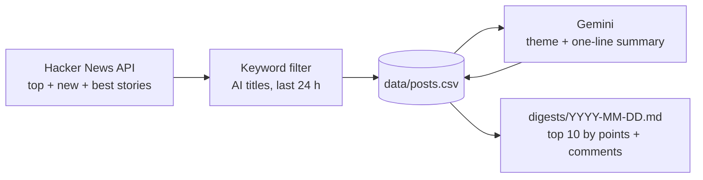

# AI News Radar

[](https://github.com/Osceti/ai-news-radar/actions/workflows/ci.yml)
[](https://github.com/Osceti/ai-news-radar/actions/workflows/daily-radar.yml)

A daily AI news digest built on the [Hacker News API](https://github.com/HackerNews/API).
Every day a GitHub Action collects the AI stories posted on Hacker News, asks an LLM
(Gemini) to label each one with a theme and a one-sentence summary, and commits a
Markdown digest of the ten most important stories to [`digests/`](digests/).

## The problem

Hacker News is one of the best places to follow AI as it happens, but on a typical day
more than a hundred AI-related stories go by, mixed with everything else on the site.
Following it closely takes time, and skimming the front page misses stories that were
popular overnight.

AI News Radar answers one question each day: *what were the ten AI stories that people
on Hacker News cared about most, and what are they about?* It also keeps every story in a
dataset, so trends (which themes rise or fade over time) can be analysed later.

## How it works



1. **Collect** ([`radar/hn.py`](radar/hn.py), [`radar/filters.py`](radar/filters.py)).
   The official API has no search endpoint, so the radar reads the ids of the current
   top, new and best stories (about 1,000 unique ids), fetches each item concurrently and
   keeps stories posted in the last 24 hours whose title matches a curated list of AI
   keywords (acronyms such as `LLM` or `RAG` are matched case-sensitively to avoid false
   positives like "rag" or "Ai Weiwei").
2. **Store** ([`radar/storage.py`](radar/storage.py)). Stories are upserted into
   [`data/posts.csv`](data/posts.csv), one row per story id: a story seen again gets its
   latest score and comment count, and keeps its theme and summary, so there are no
   duplicates and no story is classified twice.
3. **Classify** ([`radar/classifier.py`](radar/classifier.py)). Unlabelled stories are sent
   to the Gemini API in batches of 25. Structured output constrains each answer to one of
   nine fixed themes (models, agents, RAG, dev tools, security, research, business,
   regulation, other) plus a one-sentence summary written only from the title and the
   link domain. Rate-limit errors are retried with exponential backoff, and stories that
   still fail are retried on the next run.
4. **Digest** ([`radar/digest.py`](radar/digest.py)). The ten stories of the last 24 hours
   with the most points + comments are written to `digests/YYYY-MM-DD.md`, grouped by
   theme, with the link, the summary and the Hacker News discussion.

The [daily workflow](.github/workflows/daily-radar.yml) runs at 20:00 UTC: it runs the
test suite, then the pipeline, then commits the updated CSV and the new digest.
A [CI workflow](.github/workflows/ci.yml) runs the tests on every push and pull request.

### Data

`data/posts.csv` has one row per story:

| Column | Description |
| --- | --- |
| `id` | Hacker News item id |
| `created_at` | When the story was posted (UTC, ISO 8601) |
| `title`, `url`, `domain` | Story title and link (`url` is the discussion for Ask HN posts) |
| `hn_url` | Hacker News discussion |
| `score`, `num_comments` | Points and comments at the latest collection |
| `author` | Hacker News username |
| `keywords` | AI keywords that matched the title |
| `theme`, `summary` | Gemini's label and one-sentence summary (empty until classified) |
| `collected_at` | When the row was last updated |

## Example digest

An excerpt of [`digests/2026-11-12.md`](digests/2026-11-12.md), the first digest
(every digest is in [`digests/`](digests/)):

> # AI News Radar — 2026-11-12
>
> Top 10 of 125 AI-related stories posted on Hacker News in the 24 hours to 08:43 UTC, ranked by points + comments and grouped by theme.
>
> ## Agents
>
> - **[My AI agents found an unmapped Maya site?](https://pietromiotti.com/latest/maya-site)** (pietromiotti.com)\
>   AI agents allegedly found an unmapped Maya site according to a personal blog post.\
>   980 points · 357 comments · [discussion](https://news.ycombinator.com/item?id=50452455)
>
> ## RAG
>
> - **[Faster Retrieval for Better, More Efficient RAG](https://machinelearning.apple.com/research/faster-retrieval)** (machinelearning.apple.com)\
>   Apple machine learning researchers explore faster retrieval methods for more efficient RAG.\
>   204 points · 37 comments · [discussion](https://news.ycombinator.com/item?id=50455633)
>
> ## Business
>
> - **[United Airlines bans AI agents from booking flights on behalf of travelers](https://www.cbsnews.com/news/united-airlines-bans-ai-agents-booking-flights/)** (cbsnews.com)\
>   United Airlines has banned AI agents from booking flights on behalf of travelers.\
>   538 points · 522 comments · [discussion](https://news.ycombinator.com/item?id=50458900)
>
> *…*

## Run it locally

Requires Python 3.11+.

```bash
git clone https://github.com/Osceti/ai-news-radar.git
cd ai-news-radar
python -m venv .venv && source .venv/bin/activate
pip install -r requirements-dev.txt
```

Run the tests:

```bash
pytest
```

Run the whole pipeline (collect, classify, digest). Without a key, stories are stored
unclassified and the digest is still written; they are classified on the next run that
has a key.

```bash
export GEMINI_API_KEY="your-key"   # free key from https://aistudio.google.com/apikey
python -m radar run
```

Each step can also run on its own: `python -m radar collect`, `python -m radar classify`,
`python -m radar digest`. Use `--data` and `--digests` to write somewhere else, and
`--window-hours` to change the 24-hour window.

### Configuration

| Variable | Where | Default | Purpose |
| --- | --- | --- | --- |
| `GEMINI_API_KEY` | environment / repository secret | none | Gemini API key, never stored in the code |
| `GEMINI_MODEL` | environment / repository variable | `gemini-flash-lite-latest` | Gemini model used for classification |

To run the daily workflow on a fork, add `GEMINI_API_KEY` under **Settings → Secrets and
variables → Actions → New repository secret**, then start **Actions → Daily radar → Run
workflow**.

## Project structure

```text
radar/
  config.py       paths, window, digest size and the fixed list of themes
  filters.py      AI keyword filter
  hn.py           Hacker News API client
  storage.py      CSV storage with upsert
  classifier.py   Gemini classification and summaries
  digest.py       ranking and Markdown rendering
  pipeline.py     collect, classify and digest steps
  __main__.py     command line interface
tests/            pytest suite (no network access needed)
data/posts.csv    every AI story collected so far
digests/          one Markdown digest per day
```

## Evaluation

*In progress.* About 100 stories will be labelled by hand to measure how often Gemini's
theme matches the human label, with a confusion matrix and a review of the errors.

## Limitations

- Only titles are filtered, so an AI story with a title that names no AI keyword is
  missed, and a few generic matches (for example "AI" in a non-AI story) get through.
- The Hacker News API exposes the latest 500 new stories, which covers roughly the last
  half day; older stories from the 24-hour window are found through the top and best lists,
  which favours the popular ones, exactly the ones a digest needs.
- Summaries are written from the title and domain only, without reading the article.
- Points and comments are a snapshot at collection time, so a story posted just before a
  run is ranked on its early score.

## Roadmap

- [x] Daily collection, Gemini classification and digest
- [ ] Hand-labelled evaluation of the classifier
- [ ] Notebook on how themes evolve over time
- [ ] Streamlit dashboard

## License

[MIT](LICENSE)
